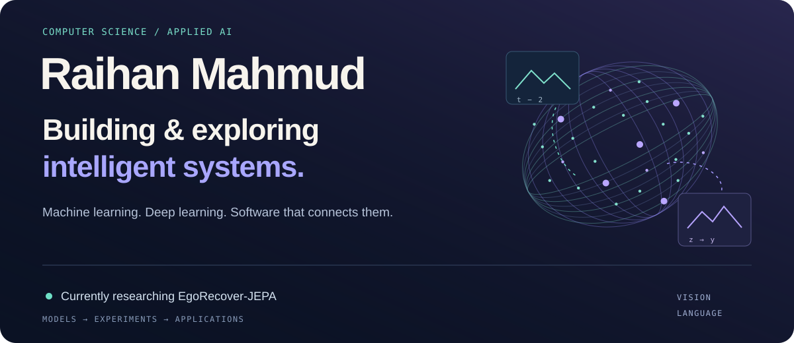
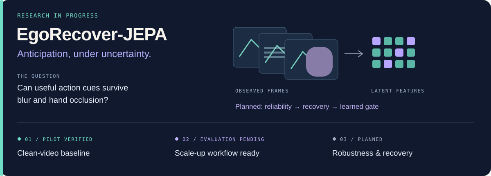
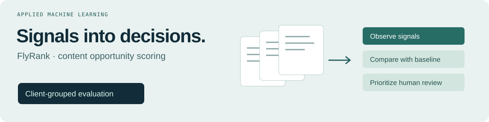
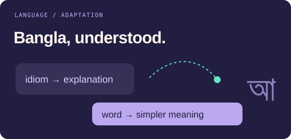
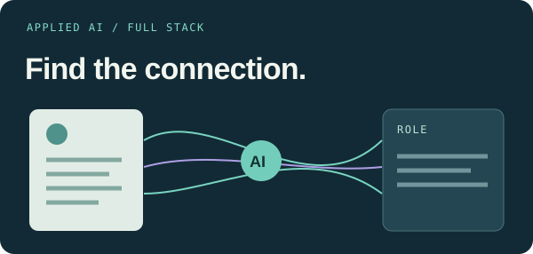
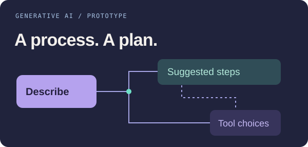
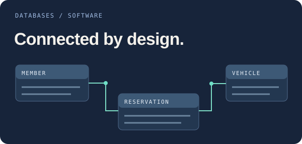

  

  
  &nbsp;
  

<strong>Models. Experiments. Working software.</strong> 
I'm Raihan Mahmud, an AI/ML enthusiast exploring computer science, machine learning, 
deep learning, and the engineering that turns model ideas into useful applications.

<a href="#research-in-progress">Currently building</a> &nbsp; / &nbsp; <a href="#featured-projects">Featured projects</a> &nbsp; / &nbsp; <a href="#about--direction">About &amp; direction</a> &nbsp; / &nbsp; <a href="https://github.com/RaihahMahmud">GitHub</a>

## Research in progress

**EgoRecover-JEPA** investigates egocentric action anticipation with a frozen **V-JEPA 2.1** video model when frames near an action suffer motion blur, hand occlusion, or both. The research direction is semantic recovery in latent feature space rather than video-pixel reconstruction.

- **Built & pilot-tested** — frozen encoder plus a trainable attentive verb/noun/action probe; an end-to-end clean-video pilot on one EPIC-KITCHENS video, with saved outputs, probe weights, and graphs. Single-pass FFmpeg decoding and feature caching reduce repeated computation.
- **Current stage** — scaling the baseline using a resumable Kaggle/Colab notebook, checksum-validated downloads, video-level splitting, and artifact backups. **The larger-scale evaluation is not complete.**
- **Next** — controlled corruption generators and robustness evaluation, then reliability estimation, V-JEPA predictor-based latent recovery, and a learned gate over observed and predicted features. The full recovery method remains planned.

<strong>Planned evaluation &amp; experiment stack</strong>

EPIC-KITCHENS-100; Recall@5 for verbs, nouns, and actions across clean and corrupted video. Planned comparisons include multiple seeds, context-length ablations, and confidence intervals. No quantitative findings are claimed from the pilot. Gaze integration is a possible future extension.

Python · PyTorch · V-JEPA 2.1 · Hugging Face Transformers · FFmpeg · pandas · matplotlib · Kaggle · Google Colab · rclone · Google Drive

## Featured projects

<!-- Keep descriptions grounded in repository source. Artwork is conceptual, not a product screenshot or a performance chart. -->

### [FlyRank — Content opportunity scoring](https://github.com/RaihahMahmud/FlyRank-AI--starter-ML-Internship-)

**Applied ML · capstone notebook** — Aggregates page-level search data with DuckDB and pandas, then compares standardized logistic regression with a rule baseline using a client-grouped split. Its target is observed click volume above the training-set median: a proxy task, not evidence that refreshing a page improves future traffic.

Python / scikit-learn / pandas / DuckDB 
[Explore the capstone notebook →](https://github.com/RaihahMahmud/FlyRank-AI--starter-ML-Internship-/blob/main/work/notebooks/capstone.ipynb)

<table>
<tr>
<td width="50%" valign="top">

<h3><a href="https://github.com/RaihahMahmud/Bangla_grammar_Chatbot_299project">Bangla Grammar Chatbot</a></h3>

<strong>Language technology · experimental</strong> Training code and local inference diagnostics for idiom explanations and word simplification. The Colab script configures Qwen2.5-1.5B-Instruct with 4-bit loading and LoRA adapters. No benchmarked release is claimed.

Python / PyTorch / Unsloth / PEFT / TRL

<a href="https://github.com/RaihahMahmud/Bangla_grammar_Chatbot_299project/blob/main/%23%23CollabCodeForModeltrain.txt">Training workflow →</a> · <a href="https://github.com/RaihahMahmud/Bangla_grammar_Chatbot_299project/blob/main/test_model.py">Diagnostics</a>

</td>
<td width="50%" valign="top">

<h3><a href="https://github.com/RaihahMahmud/TalentFlow_synapse_AI_B2B">TalentFlow · Synapse AI</a></h3>

<strong>Applied AI · full-stack application</strong> Structured CV extraction and candidate-to-requisition scoring. Gemini returns Zod-validated structured output; deterministic weighted skill overlap grounds the scoring prompt. Next.js and Prisma/PostgreSQL connect the features to the application.

TypeScript / React / Next.js / Gemini API / Prisma

<a href="https://github.com/RaihahMahmud/TalentFlow_synapse_AI_B2B/blob/main/src/lib/cv-parsing.ts">CV extraction →</a> · <a href="https://github.com/RaihahMahmud/TalentFlow_synapse_AI_B2B/blob/main/src/lib/scoring/score-candidate.ts">Scoring</a>

</td>
</tr>
<tr>
<td width="50%" valign="top">

<h3><a href="https://github.com/RaihahMahmud/AetherFlow-AI">AetherFlow AI</a></h3>

<strong>Generative AI · prototype</strong> Turns a business-process description into a suggested automation strategy using schema-constrained Gemini JSON. React displays the steps and technologies; generated savings estimates are model suggestions, not measured outcomes.

TypeScript / React / Gemini API

<a href="https://github.com/RaihahMahmud/AetherFlow-AI/blob/main/services/geminiService.ts">Generation service →</a>

</td>
<td width="50%" valign="top">

<h3><a href="https://github.com/RaihahMahmud/TechWheels_DB_SQL_project_CUNY">TechWheels</a></h3>

<strong>Database engineering · application</strong> A vehicle-sharing management system with members, hubs, reservations, and maintenance. Foreign keys and constraints support the schema; Flask/SQLite implements CRUD and fleet, revenue, and member-activity reports.

Python / Flask / SQLite / SQL

<a href="https://github.com/RaihahMahmud/TechWheels_DB_SQL_project_CUNY/blob/main/techwheels_project/db/schema.sql">Relational schema →</a> · <a href="https://github.com/RaihahMahmud/TechWheels_DB_SQL_project_CUNY/blob/main/techwheels_project/app/flask_app.py">Application</a>

</td>
</tr>
</table>

## About & direction

I work across **model experiments and application engineering**: Bangla language tools, applied ML, AI-assisted workflows, and relational systems. My current focus is EgoRecover-JEPA and the move from a clean-video pilot toward a larger, reproducible evaluation.

**What I want to explore next** 
Computer vision and self-supervised representation learning; efficient adaptation for language tasks; evaluation that separates useful evidence from optimistic assumptions. These are learning and research interests, not claims of expertise or completed results.

### Tools in my projects

**Models & data** — Python · PyTorch · scikit-learn · Unsloth · PEFT / LoRA · TRL · Hugging Face Transformers · pandas · NumPy · DuckDB

**Applications** — TypeScript · React · Next.js · Flask · Gemini API · Zod · SQL · SQLite · PostgreSQL · Prisma

**Experiments & workflow** — Jupyter / Colab · Kaggle · FFmpeg · Git / GitHub · rclone / Google Drive

---

<strong>Explore the work. Follow what comes next.</strong>

<a href="https://raihanbuildsvercelapp.vercel.app/">Portfolio Website ↗</a> &nbsp; / &nbsp; <a href="https://github.com/RaihahMahmud">GitHub</a> &nbsp; / &nbsp; <a href="https://github.com/RaihahMahmud?tab=repositories">All repositories</a>

Raihan Mahmud · Computer science, learning systems &amp; software.

